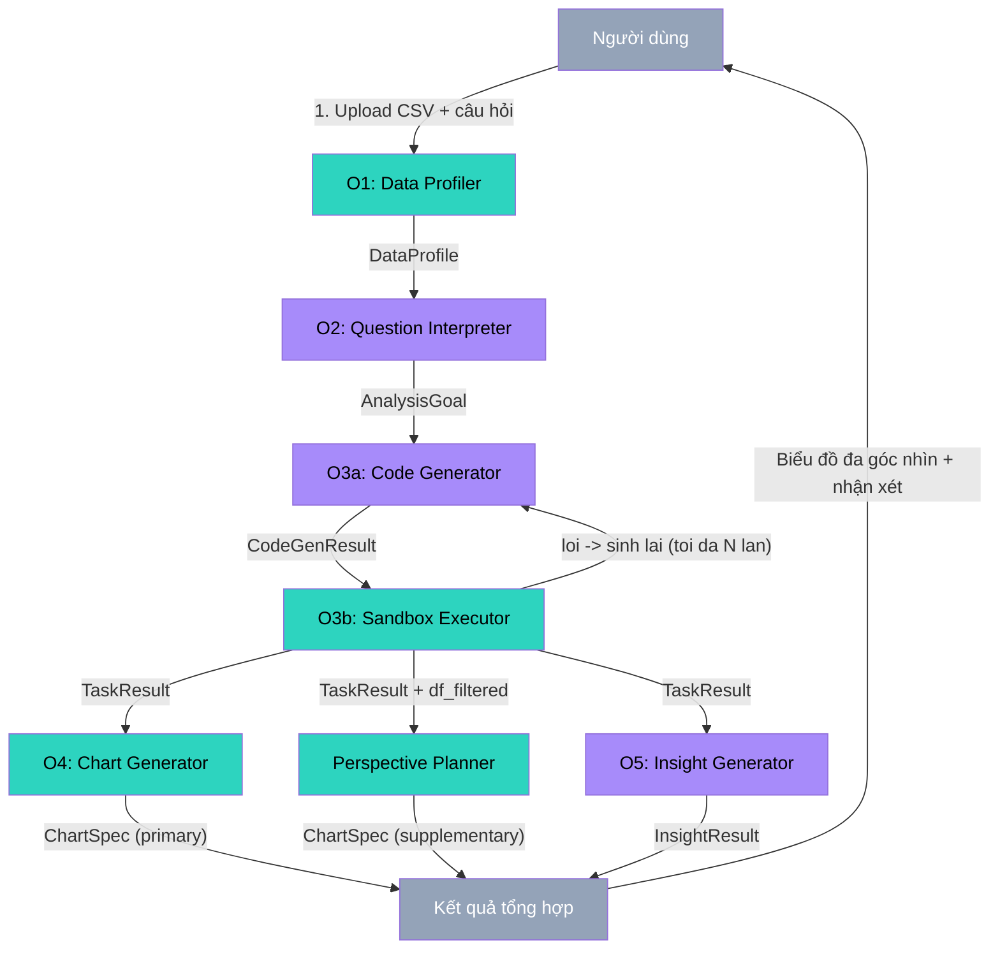
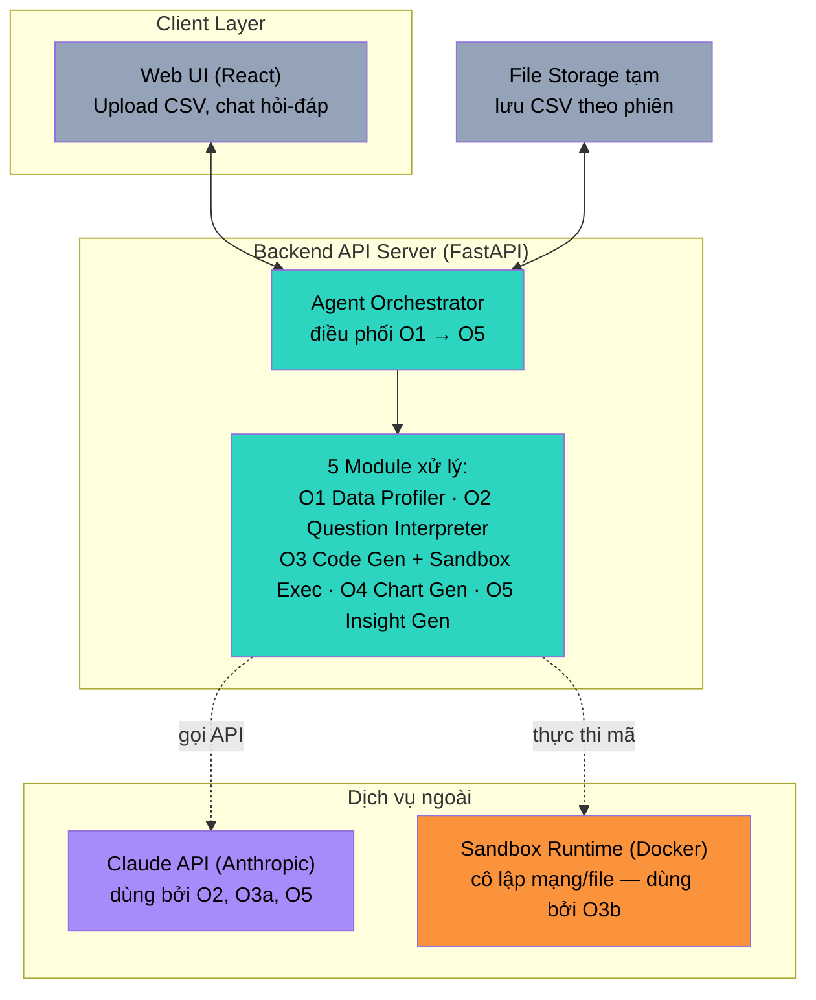

# Kiến trúc Hệ thống

## AI Agent Phân tích, Trực quan hóa và Sinh Insight từ Dữ liệu Kinh doanh

Kiến trúc kế thừa tư tưởng pipeline đa giai đoạn của LIDA (Dibia, 2023) —
tách rời bước LLM sinh mã và bước runtime thực thi mã (theo tinh thần
Program-Aided Language Models) — nhưng mở rộng thêm khả năng tính toán số
liệu thật và sinh nhận xét ngôn ngữ tự nhiên, hai việc mà LIDA gốc (tập
trung vào sinh biểu đồ/infographic) không giải quyết.

---

## 1. Sơ đồ luồng xử lý (Pipeline / Data-flow View)

**Chú thích màu:** xám = điểm vào/ra (I/O); teal = xử lý dữ liệu thuần
túy (không gọi LLM); tím = bước bắt buộc gọi API LLM.

**Triết lý phân tách LLM vs Tất định (Perspective Planner):**
- **Câu trả lời chính:** Đi qua O3 (LLM sinh mã + sandbox + retry loop), đo bằng chỉ số AER phục vụ mục tiêu nghiên cứu của đồ án.
- **Góc nhìn bổ sung (Dashboard đa góc nhìn):** Đi qua `Perspective Planner` bằng pandas thuần tất định (không gọi thêm LLM, không thêm sandbox). Cách này đảm bảo không làm đội thêm độ trễ (NFR-01 ≤ 15s), loại bỏ nguy cơ ảo giác ở các góc nhìn phụ và đảm bảo số liệu luôn nhất quán 100%.

---

## 2. Sơ đồ kiến trúc triển khai (Deployment / Component View)

**Điểm mấu chốt về bảo mật (NFR-02):** Sandbox Runtime được cô lập hoàn
toàn khỏi mạng và file hệ thống — đây là nơi DUY NHẤT thực thi mã do LLM
sinh ra. Backend API Server không bao giờ tự thực thi mã LLM sinh trực
tiếp trong tiến trình chính của mình.

---

## 3. Mô tả các thành phần

### 3.1. Client Layer
- **Web UI (React):** giao diện tải file, khung chat đặt câu hỏi, khu vực hiển thị biểu đồ + bảng + nhận xét. Xây dựng ở Tuần 7.

### 3.2. Backend API Server (FastAPI)
- **Agent Orchestrator:** điều phối tuần tự 5 module theo đúng sơ đồ mục 1, xử lý lỗi và giới hạn số lần retry cho O3.
- **5 Module xử lý:** xem chi tiết interface tại `docs/SRS.md` (mục 6) và mã nguồn tại `backend/app/modules/`.

### 3.3. Dịch vụ ngoài
- **Gemini API (Google GenAI) / Claude API (Anthropic):** dùng cho 3 module cần suy luận ngôn ngữ tự do — O2 (hiểu câu hỏi), O3a (sinh mã), O5 (sinh nhận xét). Nhờ thiết kế trừu tượng hoá qua `LLMClient` (Python `Protocol` trong `backend/app/llm_client.py`), hệ thống có thể chuyển đổi linh hoạt giữa Gemini (`gemini-2.5-flash` / `gemini-1.5-flash`) và Claude (`claude-3-5-sonnet`) mà không làm thay đổi bất kỳ logic nghiệp vụ nào trong O1, O2, O3, O5. Hiện tại Gemini được đặt làm cấu hình mặc định.
- **Sandbox Runtime:** container cô lập chạy mã pandas do O3a sinh ra, chỉ nhận DataFrame làm input, không có quyền mạng/file hệ thống ngoài.

### 3.4. Dịch vụ Báo cáo & Xuất dữ liệu (Reporting & Export Layer)
Hệ thống hỗ trợ xuất báo cáo đa định dạng (PDF, Excel, PNG, CSV) theo nguyên tắc: **chất lượng cao nhất với chi phí vận hành tối ưu**:
- **Xuất Excel (.xlsx) phía Backend (`/export/xlsx`):**
  - Thực hiện trên FastAPI bằng thư viện `xlsxwriter`.
  - Sinh bảng tính gồm: Sheet "Tóm tắt" (mục tiêu, nhận xét AI, metadata), các Sheet riêng cho từng biểu đồ chứa bảng số liệu và **biểu đồ Excel gốc (native chart)** có thể chỉnh sửa trực tiếp trong Excel.
  - An toàn dữ liệu: Áp dụng cơ chế chống chèn mã/công thức nguy hiểm (Formula Injection Protection) bằng cách ép kiểu `write_string` cho mọi nhãn danh mục bắt đầu bằng `=`, `+`, `-`, `@`. Tên sheet được chuẩn hoá an toàn (`safe_sheet_name` ≤ 31 ký tự, lọc ký tự cấm).
- **Xuất PDF Vector qua `window.print()` phía Client:**
  - Lựa chọn giải pháp in trang tài liệu A4 (`ReportDocument`) thông qua lệnh in vector của trình duyệt thay vì chụp ảnh canvas bitmap (`html2canvas` + `jsPDF`) hoặc dựng renderer riêng (`@react-pdf/renderer`).
  - Lợi ích: Văn bản và biểu đồ SVG vector sắc nét 100%, có thể bôi đen/sao chép/tìm kiếm chữ, kiểm soát ngắt trang chuẩn bằng CSS `@page` và `break-inside: avoid`, không làm phình dung lượng file và không cần cài đặt hạ tầng Chromium không đầu (Playwright/WeasyPrint) nặng nề trên server.
- **Xuất ảnh PNG từng biểu đồ (`html-to-image`):**
  - Chụp toàn bộ thẻ `ChartCard` (bao gồm tiêu đề, biểu đồ SVG, chú giải Legend HTML bên ngoài SVG, và chú thích caption) với `pixelRatio: 2` trên nền sáng chuẩn in ấn.

### 3.5. File Storage tạm
- Lưu file CSV người dùng tải lên trong phạm vi phiên làm việc (session), không lưu trữ vĩnh viễn ở giai đoạn MVP.

---

## 4. Ánh xạ công nghệ

| Thành phần | Công nghệ | Trạng thái |
|---|---|---|
| Backend framework | FastAPI | Đã triển khai (`backend/app/main.py`) |
| Xử lý dữ liệu | pandas + openpyxl | Đã cài đặt (O1, bao gồm đọc .xlsx) |
| Xuất báo cáo Excel | XlsxWriter | Đã cài đặt (`backend/app/modules/excel_exporter.py`) |
| Validation / I/O contract | Pydantic v2 | Đã định nghĩa (`backend/app/schemas.py`) |
| LLM | Gemini API (`google-genai`) làm mặc định + Claude API (`anthropic`) qua `LLMClient` Protocol | Đã tích hợp (`llm_client.py`) |
| Sandbox | Subprocess spawn + AST check cô lập | Đã hoàn thành Tuần 4 |
| Biểu đồ | Recharts + CSS Design Tokens | Đã tích hợp Tuần 7 |
| Frontend | React + TypeScript + Vite | Đã hoàn thành (Giao diện chuẩn hóa, App Rail, Query Bar, ChartCard) |
| CI/CD | GitLab CI / GitHub Actions | Đã cấu hình lint, test, docker build & deploy |

---

## 5. Nguyên tắc thiết kế kế thừa từ LIDA (Dibia, 2023)

1. **Tách bước sinh mã (LLM) và bước thực thi mã (runtime)** — theo tinh thần Program-Aided Language Models — đảm bảo số liệu chính xác thay vì để LLM tự nhẩm.
2. **Fill-in-the-middle + code scaffold** cho O3a — giới hạn phạm vi mã LLM có thể sinh ra, tăng an toàn khi thực thi.
3. **Lọc lỗi nhiều tầng** ở O3b — loại bỏ ứng viên lỗi biên dịch, tự sinh lại khi thất bại, giới hạn số lần thử để tránh vòng lặp vô hạn / chi phí API không kiểm soát.
4. **Tự đánh giá chất lượng đầu ra** ở O5 (tinh thần SEVQ) — trước khi trả nhận xét về cho người dùng.
5. **Module hóa rõ ràng theo interface (I/O contract)** — mỗi module có thể phát triển, kiểm thử, thay thế độc lập (NFR-05), đúng tinh thần "flexible" mà LIDA đề cao.
6. **Kiến trúc giải trình & kiểm chứng (Verifiability)** — Báo cáo xuất ra (PDF/Excel) luôn kèm theo Phụ lục bảng số liệu chi tiết và phương pháp tính toán để người dùng và các bên liên quan kiểm tra đối chiếu.

---

## 6. Trạng thái hiện tại

| Module / Tính năng | Trạng thái |
|---|---|
| O1 — Data Profiler (Stage 0+1+2) | ✅ Hoàn thành — hỗ trợ số Việt Nam, từ điển tên hiển thị, đơn vị |
| O2 — Question Interpreter | ✅ Hoàn thành — prompt few-shot, grounding check |
| O3a — Code Generator | ✅ Hoàn thành — 3 scaffold, error feedback loop |
| O3b — Sandbox Executor | ✅ Hoàn thành — AST check 3 lớp, spawn timeout OS |
| Orchestrator (analysis_runner) | ✅ Hoàn thành — retry 3 lần, lọc thời gian tất định |
| O4 — Chart Generator | ✅ Hoàn thành — 5 loại biểu đồ, Việt hóa tiêu đề |
| Perspective Planner | ✅ Hoàn thành — 6 góc nhìn bổ sung tất định, caption tự động |
| O5 — Insight Generator | ✅ Hoàn thành — trích xuất số liệu, SEVQ, bảo toàn tên nhóm thực tế |
| Frontend UI Redesign | ✅ Hoàn thành — App Rail, Query Bar, Result Toolbar, ChartCard chuẩn A5, tokens.css |
| Tính năng Xuất báo cáo | ✅ Hoàn thành — PDF A4 vector, Excel gốc XlsxWriter, PNG thẻ, CSV UTF-8 BOM |

---

## 7. Giới hạn thật của Sandbox Executor (O3b)

> **Dành cho báo cáo đồ án:** Hội đồng chấm thường hỏi về bảo mật sandbox — tốt hơn nên chủ động nêu trước.

### 7.1. Bảo vệ được

| Mối đe dọa | Lớp phòng thủ | Kết quả |
|---|---|---|
| `import os`, `import subprocess` | Lớp 1 — AST check | ✅ Chặn TRƯỚC khi exec |
| Gọi `eval`, `exec`, `open` | Lớp 1 — AST check | ✅ Chặn TRƯỚC khi exec |
| Truy cập dunder (`__class__`, `__globals__`) | Lớp 1 — AST check | ✅ Chặn TRƯỚC khi exec |
| Vòng lặp vô hạn / code treo server | Lớp 2 — `process.join(timeout)` + `terminate()` | ✅ Kill ở tầng OS sau N giây |
| Built-in Python mặc định | Lớp 3 — `exec(__builtins__={})` | ✅ Giảm bề mặt tấn công |

### 7.2. Giới hạn rõ ràng

**Bảo mật:** AST check không chặn được các kỹ thuật bypass đã biết công khai (vd: leo thang qua `__subclasses__()`). Cách an toàn thật sự ở production là container hoá (Docker/gVisor). Sandbox hiện tại chỉ cam kết chống **lỗi không chủ ý** của LLM, không cam kết chống **tấn công chủ ý** — rủi ro chủ ý rất thấp vì người dùng không tự viết mã.

**Windows:** `resource.setrlimit` (giới hạn RAM) không có trên Windows — bỏ qua khi dev local. Được áp dụng tự động trên Linux/Mac. Giới hạn RAM thật sự đảm bảo khi deploy qua Docker (`--memory=512m`).

**Đa luồng:** Dùng `get_context("spawn")` thay vì `fork` mặc định để tránh deadlock trong môi trường FastAPI đa luồng — spawn nhất quán trên cả 3 hệ điều hành.
