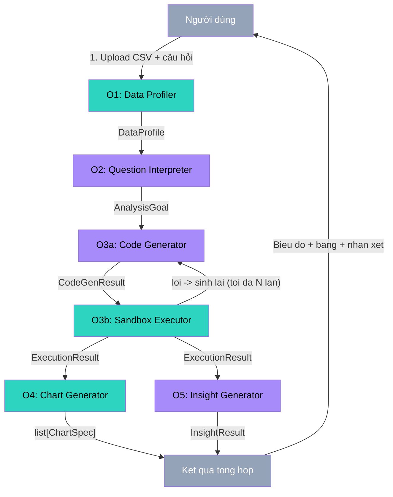
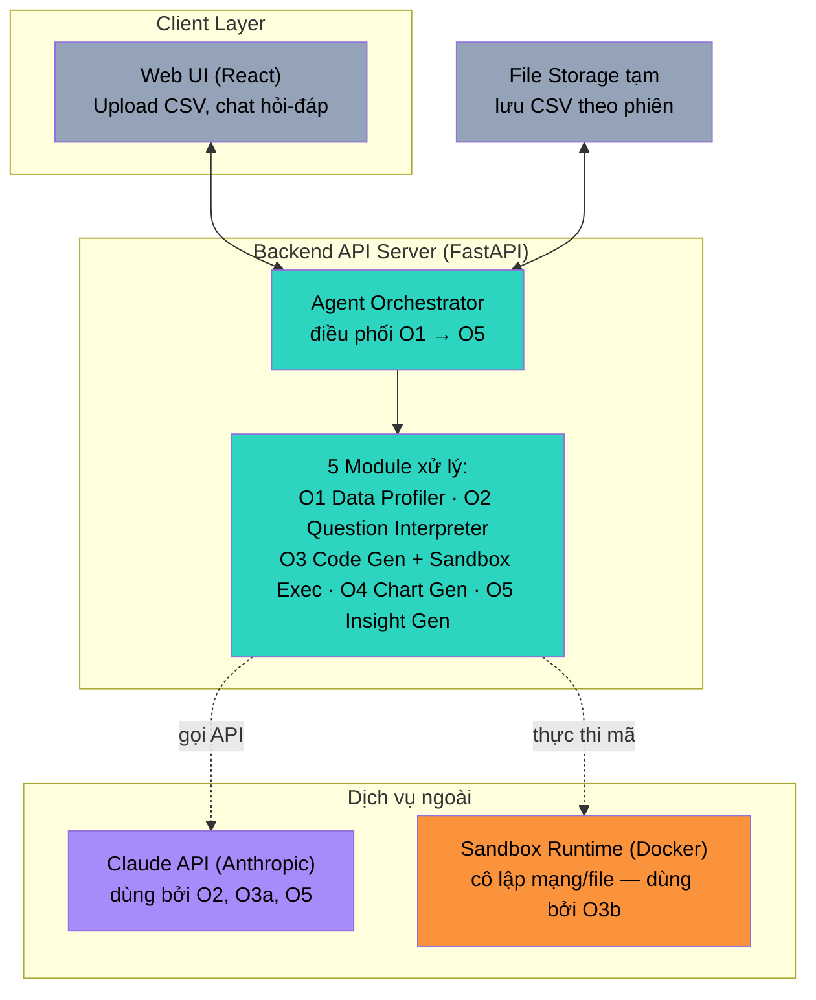

# Kiến trúc Hệ thống

## AI Agent Phân tích, Trực quan hóa và Sinh Insight từ Dữ liệu Kinh doanh

Kiến trúc kế thừa tư tưởng pipeline đa giai đoạn của LIDA (Dibia, 2023) —
tách rời bước LLM sinh mã và bước runtime thực thi mã (theo tinh thần
Program-Aided Language Models) — nhưng mở rộng thêm khả năng tính toán số
liệu thật và sinh nhận xét ngôn ngữ tự nhiên, hai việc mà LIDA gốc (tập
trung vào sinh biểu đồ/infographic) không giải quyết.

---

## 1. Sơ đồ luồng xử lý (Pipeline / Data-flow View)

**Chú thích màu:** xám = điểm vào/ra (I/O); teal = xử lý dữ liệu thuần
túy (không gọi LLM); tím = bước bắt buộc gọi API LLM.

---

## 2. Sơ đồ kiến trúc triển khai (Deployment / Component View)

**Điểm mấu chốt về bảo mật (NFR-02):** Sandbox Runtime được cô lập hoàn
toàn khỏi mạng và file hệ thống — đây là nơi DUY NHẤT thực thi mã do LLM
sinh ra. Backend API Server không bao giờ tự thực thi mã LLM sinh trực
tiếp trong tiến trình chính của mình.

---

## 3. Mô tả các thành phần

### 3.1. Client Layer
- **Web UI (React):** giao diện tải file, khung chat đặt câu hỏi, khu vực hiển thị biểu đồ + bảng + nhận xét. Xây dựng ở Tuần 7.

### 3.2. Backend API Server (FastAPI)
- **Agent Orchestrator:** điều phối tuần tự 5 module theo đúng sơ đồ mục 1, xử lý lỗi và giới hạn số lần retry cho O3.
- **5 Module xử lý:** xem chi tiết interface tại `docs/SRS.md` (mục 6) và mã nguồn tại `backend/app/modules/`.

### 3.3. Dịch vụ ngoài
- **Claude API:** dùng cho 3 module cần suy luận ngôn ngữ tự do — O2 (hiểu câu hỏi), O3a (sinh mã), O5 (sinh nhận xét). Xem bảng phân loại "gọi API vs tự viết" tại `docs/SRS.md` mục 7.
- **Sandbox Runtime:** container cô lập chạy mã pandas do O3a sinh ra, chỉ nhận DataFrame làm input, không có quyền mạng/file hệ thống ngoài.

### 3.4. File Storage tạm
- Lưu file CSV người dùng tải lên trong phạm vi phiên làm việc (session), không lưu trữ vĩnh viễn ở giai đoạn MVP.

---

## 4. Ánh xạ công nghệ

| Thành phần | Công nghệ | Trạng thái |
|---|---|---|
| Backend framework | FastAPI | Đã scaffold (`backend/app/main.py`) |
| Xử lý dữ liệu | pandas + openpyxl | Đã cài đặt (O1, bao gồm đọc .xlsx) |
| Validation / I/O contract | Pydantic v2 | Đã định nghĩa (`backend/app/schemas.py`) |
| LLM | Gemini API (google-genai) + Claude API (Anthropic) | Đã tích hợp Tụàn 3 (`llm_client.py`) |
| Sandbox | Docker container / subprocess giới hạn quyền | Chưa cài đặt — dự kiến Tuần 4 |
| Biểu đồ | Plotly hoặc Recharts | Chưa tích hợp — dự kiến Tuần 5 |
| Frontend | React | Chưa khởi tạo — dự kiến Tuần 7 |
| CI | GitHub Actions (`.github/workflows/ci.yml`) | Đã cấu hình cơ bản (lint + test) |

---

## 5. Nguyên tắc thiết kế kế thừa từ LIDA (Dibia, 2023)

1. **Tách bước sinh mã (LLM) và bước thực thi mã (runtime)** — theo tinh thần Program-Aided Language Models — đảm bảo số liệu chính xác thay vì để LLM tự nhẩm.
2. **Fill-in-the-middle + code scaffold** cho O3a — giới hạn phạm vi mã LLM có thể sinh ra, tăng an toàn khi thực thi.
3. **Lọc lỗi nhiều tầng** ở O3b — loại bỏ ứng viên lỗi biên dịch, tự sinh lại khi thất bại, giới hạn số lần thử để tránh vòng lặp vô hạn / chi phí API không kiểm soát.
4. **Tự đánh giá chất lượng đầu ra** ở O5 (tinh thần SEVQ) — trước khi trả nhận xét về cho người dùng.
5. **Module hóa rõ ràng theo interface (I/O contract)** — mỗi module có thể phát triển, kiểm thử, thay thế độc lập (NFR-05), đúng tinh thần "flexible" mà LIDA đề cao.

---

## 6. Trạng thái hiện tại (Tuần 4/8)

| Module | Trạng thái |
|---|---|
| O1 — Data Profiler (Stage 0+1+2) | ✅ Đầy đủ — 13+ test |
| O2 — Question Interpreter | ✅ Đầy đủ — 10 test, endpoint `/interpret` |
| O3a — Code Generator | ✅ Tuần 4 — 3 scaffold, 3 bộ few-shot, error feedback, 8 test |
| O3b — Sandbox Executor | ✅ Tuần 4 — AST check + spawn timeout + exec giới hạn, 12 test |
| Orchestrator (analysis_runner) | ✅ Tuần 4 — lọc thời gian + retry 3 lần, 5 test |
| O4 — Chart Generator | ⏳ Stub — Tuần 5 |
| O5 — Insight Generator | ⏳ Stub — Tuần 6 |
| Frontend | ⏳ Chưa khởi tạo — Tuần 7 |

---

## 7. Giới hạn thật của Sandbox Executor (O3b)

> **Dành cho báo cáo đồ án:** Hội đồng chấm thường hỏi về bảo mật sandbox — tốt hơn nên chủ động nêu trước.

### 7.1. Bảo vệ được

| Mối đe dọa | Lớp phòng thủ | Kết quả |
|---|---|---|
| `import os`, `import subprocess` | Lớp 1 — AST check | ✅ Chặn TRƯỚC khi exec |
| Gọi `eval`, `exec`, `open` | Lớp 1 — AST check | ✅ Chặn TRƯỚC khi exec |
| Truy cập dunder (`__class__`, `__globals__`) | Lớp 1 — AST check | ✅ Chặn TRƯỚC khi exec |
| Vòng lặp vô hạn / code treo server | Lớp 2 — `process.join(timeout)` + `terminate()` | ✅ Kill ở tầng OS sau N giây |
| Built-in Python mặc định | Lớp 3 — `exec(__builtins__={})` | ✅ Giảm bề mặt tấn công |

### 7.2. Giới hạn rõ ràng

**Bảo mật:** AST check không chặn được các kỹ thuật bypass đã biết công khai (vd: leo thang qua `__subclasses__()`). Cách an toàn thật sự ở production là container hoá (Docker/gVisor). Sandbox hiện tại chỉ cam kết chống **lỗi không chủ ý** của LLM, không cam kết chống **tấn công chủ ý** — rủi ro chủ ý rất thấp vì người dùng không tự viết mã.

**Windows:** `resource.setrlimit` (giới hạn RAM) không có trên Windows — bỏ qua khi dev local. Được áp dụng tự động trên Linux/Mac. Giới hạn RAM thật sự đảm bảo khi deploy qua Docker (`--memory=512m`).

**Đa luồng:** Dùng `get_context("spawn")` thay vì `fork` mặc định để tránh deadlock trong môi trường FastAPI đa luồng — spawn nhất quán trên cả 3 hệ điều hành.
